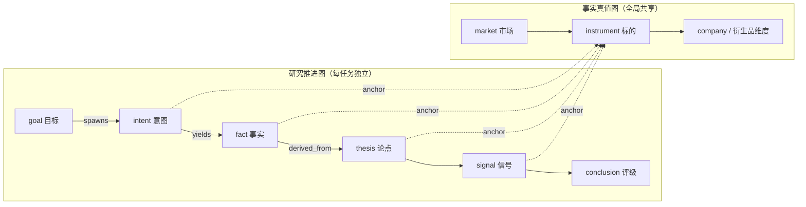
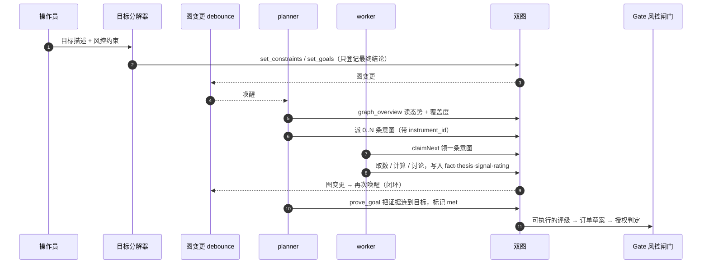

<div align="center">

# Terix

~~目标驱动的自动化金融交易平台~~

**AI 赌博平台**（自称）

~~Goal-driven autonomous financial trading platform~~

*AI-powered gambling platform, allegedly*

`ARTEX` 双图框架 × `TradingAgents` 多 Agent 讨论 × 目标驱动闭环 × 一点点运气

[](LICENSE)

</div>

> **先说清楚**：不收注、不设赔率、不提供任何赌博服务。叫「AI 赌博平台」，只是因为多空辩论、风控讨论、组合经理终审全做齐了，市场依然不太听我们的。
>
> **项目代号 Terix**，它的一生：自主渗透测试 → ~~目标驱动的自动化金融交易平台~~ → AI 赌博平台。代码库继承自 [ARTEX](https://github.com/Autumn-27/ARTEX)，Go 模块路径与可执行文件名仍叫 `artex`；本 README 描述的是**当前代码库**，不是上游 ARTEX，也不是一家赌场。
>
> **代码质量声明**：由 `deepseekflash+hy4` 全权负责。两位已就「这段到底是谁写的」完成多轮结构化辩论，裁决结果为 `review`，现已交由人工复核。本平台只负责把锅写进图谱，不负责认领。

---

## 这是什么

> 严谨版：目标驱动的自动化金融交易平台。
>
> 诚实版：十几个 LLM 围着一根 K 线开会，吵完让另一个 LLM 按下按钮，再由 Gate 决定这个按钮算不算数。

Terix 把「一个投资目标」交给一组各司其职的 LLM Agent：它们像真实投研团队一样分工取数、互相辩驳、接受风控质询，最后产出**可核验的交易信号与评级**。评级若要变成订单，还必须再过一道统一的风控闸门，落到模拟盘，或经显式授权后进入实盘通道。全过程写进图谱，可回溯到每一步工具调用与每一笔草案判定。

操作员只需回答两件事：

- **要达成什么** —— 例如「评估 NVDA 未来两周的风险收益，给出可执行信号」「在 A 股主板里挑一只低估值标的并给出建仓建议」。可以不指定标的，由系统自己选品。
- **不许做什么** —— 例如「不做空」「单笔不超过 1 万」「不碰加密」。这些会登记为硬约束，注入后续每一轮规划与执行的提示词。

系统不要求人编排流程。目标分解器（`agent/goals.go`）只登记**最终可交付的结论**与风控约束，明确禁止把取数、算指标、下单这些步骤当成目标；planner 依据图上态势补充分析意图，worker 领一条意图执行并把证据写回，直到目标被 `prove_goal` 证明。

```
目标 + 约束
   │  set_goals / set_constraints
   ▼
双图初始化 → 阶段图确定性展开
   ▼
分析师并行取数 → 多空辩论 → 研究经理裁决 → 交易员出信号
   ▼
风控三方讨论 → 组合经理六值评级
   ▼
订单草案 → Gate 风控闸门 → paper 模拟盘 / live_auto 实盘
```

> 流程看着很严谨。唯一没画出来的是：市场并没有收到这份会议纪要。

---

## 设计来源

这个项目是两套已有框架的**组合与领域迁移**，不是从零造轮子：

| 来源 | 借用的机制 | 在 Terix 中的落点 |
| --- | --- | --- |
| **ARTEX** | **双图框架**：全局共享的事实真值图 + 每任务独立的过程推进图，靠锚点相连 | `db/instruments.go`、`db/exploration.go`、`db/task_assets.go`、`agent/pipeline.go` |
| **ARTEX** | 目标分解 + 事件驱动的 planner / worker 闭环，图一变就唤醒规划者 | `agent/goals.go`、`planner.go`、`worker.go`、`server/engine.go` |
| **ARTEX** | 人在环路审批、工具调用留痕、MCP / skills、命令拦截 | `guard/`、`intercept/`、`evidence/`、`llmrec/`、`redact/` |
| **TradingAgents** | 分析师 / 研究员 / 交易员 / 风控 / 组合经理的**角色化分工** | `agent/prompt_*.go`、`agent/promptcatalog.go`（13 个内置金融角色） |
| **TradingAgents** | 结构化**多空辩论**与**风控讨论**，用对抗式讨论替代单点判断 | `agent/pipeline.go` 阶段 3、阶段 6 |
| **TradingAgents** | 组合经理终审，给出最终决策 | `portfolio_manager` + `emit_rating` |

迁移时保留的是**骨架**（双图、目标驱动、审批留痕、阶段化讨论），替换的是**语义**：渗透里的「漏洞 / 资产 / 攻击链」变成投研里的「事实 / 标的 / 论证链」，`finding` 让位于 `fact → thesis → signal → rating`。代码里仍能看到上游遗留（如 `assets` 表保留域名/IP 字段），金融侧的标的真值层以 `instruments` 表为准。

---

## 核心机制一：双图

系统把「**研究对象是什么**」和「**研究推进到哪一步**」拆成两张相互独立、又通过锚点相连的图：

- **事实真值图（全局共享）**：以 `instruments` 为核心的标的库，覆盖美股 / 港股 / A 股 / 加密四个市场，资产类别含 `stock / etf / index / crypto`。跨任务共享、去重，是「已经确认的事实」。
- **研究推进图（每任务独立）**：一次任务的论证链。节点类型由阶段图展开为 `goal / intent / fact / thesis / signal / conclusion`，`join` 作并行汇合控制节点；边表达 `spawns / yields / derived_from / proves` 这类血缘，回答「哪个方向派生自哪些事实、产出了什么结论」。
- **锚点**：把意图、事实、论点、信号关联回具体标的，于是既能从「一个判断」看它依据哪些标的，也能从「一个标的」反查它被哪些分析覆盖过。



> 分工不变：**planner** 读推进图态势、判目标，只在确有未覆盖的新方向时派意图；**worker** 领一条意图、调用真实数据工具、把产物写回图后即停。`agent/sibling.go` 统一了「读上游兄弟节点产出」这件事——过滤作废态、按角色限额、区分 `open / standing`，避免下游基于过期论据决策。

---

## 核心机制二：目标驱动闭环

引擎是事件驱动的：图一变就唤醒 planner，planner 判目标 / 派意图，worker 领意图执行并写回，写回再触发下一轮，直到目标被证明或判定不可达。



约束不是摆设：`set_constraints` 登记的 `allow / deny` 会注入 planner 与 worker 的提示词；对话中新增目标会自动把已完成 / 暂停的任务拉回运行态，无需人工点恢复。

---

## 核心机制三：多 Agent 讨论

`agent/pipeline.go` 把一次投研任务展开成**确定性的阶段骨架**（相同输入必然产出相同节点与边），并发调度、门控与认领交给 `server/engine.go` 与 `db/exploration.go`：

| 阶段 | 角色 | 产出与说明 |
| --- | --- | --- |
| 0 选品 | `screener` | **仅任务未绑标的时**出现：把策略描述变成具体标的，选定后再展开下游阶段 |
| 1 分析师（并行） | `analyst_market` / `analyst_fundamental` / `analyst_news`；加密为 `analyst_market` / `analyst_sentiment_crypto` | 各自调用行情、财报、新闻、衍生品工具，`emit_fact` 写回证据 |
| 2 汇合 | `join_analysts` | 等待并行分析师全部完成 |
| 3 多空辩论（串行多轮） | `debate_bull` ↔ `debate_bear` | 股票默认 2 轮、加密 1 轮；逐轮读上一轮论据，`emit_thesis` 写论点 |
| 4 研究经理 | `research_manager` | 裁决多空，给出研究结论 |
| 5 交易员 | `trader` | `emit_signal` 写信号（方向 / 周期 / 置信度） |
| 6 风控讨论（并行） | `risk_aggressive` / `risk_neutral` / `risk_conservative` | 默认 1 轮；加密不含激进方 |
| 7 汇合 | `join_risk` | 汇总三方风险意见 |
| 8 组合经理 | `portfolio_manager` | `emit_rating` 六值评级，**流程终点** |

整条链就是「分析师产出 fact → 辩论读 fact 产出 thesis → 研究经理裁决 → 交易员出 signal → 风控质询 → PM 读全部产出评级」。翻译一下：一群模型在会议室里轮流说服彼此，最后请一位模型拍板，拍完大家一起看行情脸色。

**按资产类别裁剪**，且缺失的维度会显式写进 `skipped_analysts` 并在前端展示（不假装做过）：

- `stock / etf / index`：3 个分析师 + 2 轮辩论 + 3 方风控；股票社交情绪源未接入，明确跳过。
- `crypto`：2 个分析师 + 1 轮辩论 + 2 方风控；加密无财报、无新闻通道，无基本面锚时激进方前提不成立，均跳过。
- `future / option`：**拒绝展开**（保证金 / 杠杆 / 希腊字母的分析框架不同，套股票模板会「问错问题」）。

**数据工具**：`sidecars/akshare`（Python，行情 / K 线 / 技术指标、新浪财报、财新 + 财联社新闻）、`agent/mx_client.go`、`agent/okx_client.go`（加密行情、资金费率、持仓量）。OKX / MX 等市场凭证在「系统 → 凭证」页配置并脱敏回显，不写进代码。

---

## 从结论到订单：风控闸门

评级是六值之一：`buy / overweight / hold / underweight / sell / review`。只有 `buy / overweight / underweight / sell` 属于 **actionable**（可生成草案），`hold / review` 会被拒（`EXEC_RATING_NOT_ACTIONABLE`）；非法输出归一为 `review` 交由人工复核。

> 人话版：`buy` 冲、`overweight` 再冲点、`hold` 装死、`underweight` 减点、`sell` 快跑、`review` 这题我不会。

下单被拆成三个 Agent 工具，**先有草案是硬约束**：

```
create_order_draft   提案：写草案（不执行、无副作用）
        ↓
authorize_order      过闸：Gate.Authorize 重新求值风控 + 落判定记录
        ↓
execute_paper_order  执行：paper 模式记账；live_auto 走 vaultd 真实通道
```

`exec.Gate.Authorize` 是让订单从「想下」变成「能下」的**唯一入口**，没有 `force / override / skip` 旁路（`gate_bypass_test.go` 专门拦截将来有人加 bypass）。它按不可交换的顺序做三件事：① 重新求值风控（不复用草案时的结论）；② 二次校验硬上限（不信任调用方）；③ 决定 paper 还是 live。**paper 也过闸门**，否则模拟盘会放行实盘必拒的单，胜率统计就是假的。

实盘自动模式（`exec/live_auto.go`）另有五层守卫：模式守卫 → 未撤销的 `live_auto` 授权 → 同一套 Gate 判定 → 由 `(draft_id, attempt)` 确定性派生的幂等 `client_order_id` → 对账连续失败或超限立刻降级回 paper 并冻结；启动时必须拿到 leader lock，多副本下只有一个实例会真正下单。

> 冷知识：`paper` 账户是全平台唯一长期正收益的账户，这一点从未被证伪。五层守卫守卫的其实是「别把这句话当真」。

---

## 平台能力

- **单二进制交付**：Go `net/http` 后端 + Next.js 静态前端（`go:embed` 内嵌），默认 `:8787` 同时提供 UI / REST / SSE；`:8788` 为流量代理。
- **可追溯**：工具调用、LLM 收发、审批记录、活动流、草案与风控判定全部落库；`llmrec/`、`evidence/`、`redact/` 负责记录与脱敏。
- **人在环路**：`guard/` + `intercept/` 提供工具审批门与命令拦截，敏感动作可要求人工确认。
- **可配置**：多供应商 LLM（`ANTHROPIC_API_KEY` / `OPENAI_API_KEY` 或兼容端点）、MCP、skills、通知推送（钉钉 / 飞书 / 企业微信 / Webhook / Telegram / 邮件）。
- **存储**：SQLite 单文件（纯 Go 的 `modernc.org/sqlite`，无需 CGO），启动时幂等建表，`config.json` 可选。

---

## 快速开始

前置：**Go ≥ 1.26.3**、Node.js + npm、一个 LLM API Key（也可启动后在 UI 里填），以及一份「这次说不定能行」的乐观——最后这项不进 `config.json`，也不退。

### 方式一：开发模式（推荐）

```bash
./dev.sh
# 后端 :8787 / 流量代理 :8788 / 前端 http://localhost:5173
```

打开 `http://localhost:5173`，首次进入 `/setup` 设置管理员密码 → 在「系统 → LLM」配置模型 → 创建任务，填写**目标**与**约束**（可留标的为空让系统选品）。

### 方式二：源码编译单二进制

```bash
cd web && npm ci && npm run build:static && cd ..
cp -r web/out server/webui/dist
CGO_ENABLED=0 go build -tags embedui -o artex ./cmd/artex
./start.sh                       # 默认 :8787；参数原样透传，如 ./start.sh -addr :9000
```

### 方式三：Docker Compose（仅本地构建）

> **安全约束**：禁止使用任何外部预构建镜像（已确认存在后门）。`docker-compose.yml` 只从本仓库源码构建，并设了 `pull_policy: never`。

```bash
cp .env.example .env             # 填 LLM Key；不要配置任何镜像 tag
./build.sh --target linux/amd64  # 先产出二进制
mkdir -p dist/amd64 && cp dist/artex-linux-amd64/artex dist/amd64/artex
docker compose up -d --build
# → http://localhost:8787
```

arm64 目标改 `TARGETARCH=arm64` 并准备 `dist/arm64/artex`。其余细节见下方「部署说明」第 4 节。

`./skills` 与 `./data`（SQLite 库及 WAL）以绑定挂载持久化；`jwt.key` 位于容器 `/app`，需额外挂载，见下方「部署说明」。

> **注意（与上游版本的差异）**
> - **禁止外部镜像**：仓库已删除所有远程镜像引用与镜像 tag 配置，`install.sh` / `update.sh` 的远程拉取逻辑也已移除；部署一律从源码本地构建。若配置里重新出现远程 `image:` 或 `docker compose pull`，应视为被篡改并立即停止部署。
> - 当前默认 **SQLite**，不需要 PostgreSQL。`.env.example` 里的 `POSTGRES_*` 与 `install.sh` 的本地 Postgres 分支是上游遗留，请用上面的 `dev.sh` / 源码编译方式。
> - **自更新已禁用**：不要运行 `update.sh`，也不要使用页面的「一键更新 / 回滚」。上游发布源是渗透版 ARTEX，启用会把 Terix 静默覆盖回去（详见 `selfupdate/disabled.go`）。升级请走本仓库的源码构建流程。
> - 仓库中没有 `screenshots/` 目录，旧版 README 的截图链接已移除。

---

<!-- DEPLOYMENT-RUNBOOK: 本章是部署权威说明。若与上文「快速开始」或仓库脚本注释冲突，以本章为准。 -->

## 部署说明（面向部署 Agent）

> 本章写给**自动化部署这个应用的 Agent**：命令可直接执行，含前置检查、禁止项、验证契约与交付回执。
> **权威顺序**：本章 > 上文「快速开始」 > 仓库内脚本注释。代码库继承自上游渗透版 ARTEX，留下一批会误导人的脚本与注释。
> 模块路径与可执行文件名仍是 `artex`，这是继承上游，不是部署错了对象。

### 0. 五条硬约束（违反即部署失败或数据损坏）

1. **不要运行 `install.sh` / `update.sh` / 页面的「一键更新 / 回滚」**。`install.sh` 会生成 PostgreSQL 版 `config.json`（当前是 SQLite）；`update.sh` 是上游遗留脚本（远程拉取已移除，仍不要用它升级）；自更新已在编译期禁用（`selfupdate.Enabled = false`）。升级走第 8 节的手工换装。
2. **不要配置 PostgreSQL**。`.env.example` 里的 `POSTGRES_*`、`install.sh` 的本地 Postgres 分支、`docker-compose.bench.yml` 都是上游遗留。数据库是单个 SQLite 文件（`modernc.org/sqlite`，无 CGO），启动时幂等建表，**不需要任何数据库服务**。
3. **不要用 `dev-up.sh` / `start.bat` 做部署**。里面写死了某台 Windows 机器的绝对路径、venv 路径与本地代理，仅适用于原作者本机。
4. **禁止使用任何外部预构建镜像**（已确认存在后门）。`docker-compose.yml` 已删除远程 `image` 字段，改为本地 `build` + `pull_policy: never`；部署只能按第 4 节从源码构建。不要手动改回远程镜像、不要配置镜像 tag、不要执行 `docker compose pull`。发现此类字段应视为配置被篡改并中止部署。
5. **不要覆盖或删除已有的 `data/`、`jwt.key`、`config.json`**。部署必须幂等：数据目录已存在就跳过建库；`initialized:true` 就跳过设密码，绝不重置。

### 1. 前置检查

| 项 | 要求 |
| --- | --- |
| 目标系统 | Linux / macOS / Windows；生产建议 Linux amd64/arm64 |
| 源码构建 | **Go ≥ 1.26.3**（`go.mod`）、Node.js ≥ 20 + npm（Next 16）、`rsync`（`build.sh` 用它同步静态产物） |
| 可选 sidecar | Python 3.10+ 与独立 venv（A 股 / 港股 / 美股行情需要） |
| 端口 | `8787` HTTP UI/REST/SSE（**唯一必需**）；`8791` akshare sidecar（可选）；`8788` 只是 `-proxy` 兼容参数，**当前版本无监听**，不要拿它做健康检查 |
| 可写目录 | 二进制同级目录（`jwt.key`、`config.json`、`skills/`）、`data/`（SQLite 及 WAL） |

```bash
go version          # 低于 1.26.3 时不要改 go.mod 降级，改用预编译产物或在构建机编译后拷贝
node -v && npm -v && command -v rsync
file ./artex 2>/dev/null || true   # 仓库根的 ./artex 是本机构建产物，跨平台部署不要直接拷
mkdir -p data skills && test -w . && test -w data && echo "目录可写"
```

> 若本机 Go 版本不足，优先使用 release zip 或第 3 节在具备工具链的构建机上产出二进制。

### 2. 选择部署方式

| 场景 | 走哪条路 |
| --- | --- |
| 已有 release zip 或目标平台二进制 | **A：预编译单二进制**（最快） |
| 只有源码、要生产单二进制 | **B：源码构建**（`build.sh`） |
| 必须容器化 | **C：本地构建镜像** |
| 仅调试 / 二次开发 | `dev.sh`（**不算部署**，前端走 next dev；脚本提示 5173，但 `next dev` 实际默认 3000，以实际监听为准） |

### 3. 方式 A / B：单二进制（推荐）

**构建**（仅方式 B 需要）：

```bash
cd /path/to/Terix
./build.sh --target linux/amd64     # 自动 npm ci → build:static → rsync → go build -tags embedui
                                    # 产物：dist/artex-linux-amd64/artex
./build.sh --release                # 另打 zip（含 start.sh、skills/、config.example.json、README）与 SHA256SUMS
ARTEX_SKIP_FRONTEND=1 ./build.sh    # CI 复用已有 server/webui/dist 时用
```

> **没有 `-tags embedui` 的二进制不含前端**，访问首页会返回 404「前端未内嵌到此二进制」。`build.sh` 已带该 tag。

**安装**（示例目录 `/opt/terix`，可替换；release zip 解压后已含 `artex` / `start.sh` / `skills` / `config.example.json`，`bin` 与 `sidecars` 需从源码树补拷，仅 OKX / akshare 功能需要）：

```bash
sudo mkdir -p /opt/terix/data /opt/terix/skills /opt/terix/bin /opt/terix/sidecars
sudo cp dist/artex-linux-amd64/artex /opt/terix/artex
sudo cp start.sh config.example.json /opt/terix/
sudo cp -R bin/. /opt/terix/bin/                  # bin/okx 是 OKX CLI 入口；加密行情可选
sudo cp -R sidecars/. /opt/terix/sidecars/
sudo cp -R skills/. /opt/terix/skills/ 2>/dev/null || true
sudo chmod +x /opt/terix/artex /opt/terix/start.sh
```

`start.sh` 会 `cd` 到自身所在目录、把 `$PWD/bin` 加进 PATH，然后找同级的 `./artex` —— **两者必须同目录，且必须从这个目录启动**。若启用 OKX CLI，还需在 `sidecars/okx` 执行 `npm ci`。

**配置**（可省略，不写也能起）：不创建 `config.json` 时走默认路径 `<二进制同级>/data/quantex.db`，与下面这份配置等价。`config.example.json` 只是模板，程序不读它；要显式指定路径就复制成 `/opt/terix/config.json` 并改成实际值：

```json
{
  "database": { "path": "/opt/terix/data/quantex.db" },
  "skill_dir": "/opt/terix/skills"
}
```

优先级：`ARTEX_DB_PATH` > `config.json` 的 `database.path` > `<二进制同级>/data/quantex.db`；相对路径按**二进制所在目录**解析，不是 CWD。`ARTEX_CONFIG` 指定其它配置文件，`ARTEX_SKILL_DIR` 覆盖 `skill_dir`。
**`-data` 只影响工作区数据目录，不决定 SQLite 库位置**；`-addr :8787` 决定 HTTP 监听；`-proxy` 当前为兼容参数，无实际监听。

**启动与守护**：

```bash
cd /opt/terix
ANTHROPIC_API_KEY=... ./start.sh -addr :8787
# 后台：nohup ./start.sh -addr :8787 > /opt/terix/artex.log 2>&1 &
```

`start.sh` 是守护脚本：正常退出 0 → 停止循环；崩溃 → 退避重拉（1→2→…最多 60s）；退出码 75 → 立即重启（自更新协议保留，但更新已禁用，实际不会触发）；并转发 SIGTERM 给子进程。用 systemd 托管时（`User=terix` 需预先创建并授予目录写权限）：

```ini
[Unit]
Description=Terix (artex backend)
After=network.target

[Service]
Type=simple
WorkingDirectory=/opt/terix
Environment=ARTEX_DB_PATH=/opt/terix/data/quantex.db
EnvironmentFile=-/opt/terix/.env
ExecStart=/opt/terix/start.sh -addr :8787
Restart=on-failure
RestartSec=5
User=terix

[Install]
WantedBy=multi-user.target
```

### 4. 方式 C：容器

`Dockerfile` **只装运行环境、不编译**，它 `COPY dist/${TARGETARCH}/artex`，所以必须先准备对应架构的 Linux 二进制：

```bash
./build.sh --target linux/amd64
mkdir -p dist/amd64 && cp dist/artex-linux-amd64/artex dist/amd64/artex
docker build --build-arg TARGETARCH=amd64 -t terix:local .
mkdir -p data skills && touch jwt.key && chmod 600 jwt.key

# --pull=never：本地 tag 不存在时也绝不向镜像仓库发起拉取
docker run -d --pull=never --name terix -p 8787:8787 \
  -e ARTEX_DB_PATH=/app/data/quantex.db \
  -e ANTHROPIC_API_KEY="$ANTHROPIC_API_KEY" \
  -v "$PWD/data:/app/data" \
  -v "$PWD/skills:/app/skills" \
  -v "$PWD/jwt.key:/app/jwt.key" \
  terix:local
```

容器专属坑：

- **`jwt.key` 写在 `/app`（二进制所在目录），不是 `/app/data`**。只挂 `data/` 会在容器重建后丢签名密钥，所有已签发 JWT 失效 —— 上面用单文件挂载解决。
- `docker-compose.yml` 已是本地 `build` + `pull_policy: never`，直接 `docker compose up -d --build`；**不要**改回远程 `image`、不要配置镜像 tag、不要执行 `docker compose pull`。`POSTGRES_*` 是上游遗留，可删。
- 唯一允许拉取的**容器镜像**是 `Dockerfile` 的官方基础镜像 `python:3.12-slim-bookworm`（构建时仍会按 `apt` / `npm` 下载依赖）；业务镜像必须本地构建，运行容器一律 `--pull=never`。
- 镜像 `CMD` 自带 `-addr :8787 -proxy :8788`，8788 无监听，映射它无意义。
- **akshare 两端共读 `AKSHARE_SIDECAR_ADDR`**（默认 `127.0.0.1:8791`）：Go 侧拿它当目标地址，sidecar 拿它当监听地址，跨容器时会冲突。最省事的是 `--network host` 并在宿主跑 sidecar（两端都保持默认），或把 sidecar 打进同一个容器一起启动。

### 5. 可选依赖：akshare sidecar

A 股 / 港股 / 美股行情工具依赖它；**不装也能启动**，只是相关工具返回 `_unavailable`，不要误判为启动失败。

```bash
python3 -m venv .venv-akshare
.venv-akshare/bin/pip install -r sidecars/akshare/requirements.txt
AKSHARE_SIDECAR_ADDR=127.0.0.1:8791 .venv-akshare/bin/python sidecars/akshare/server.py &
until curl -fsS http://127.0.0.1:8791/health 2>/dev/null | python3 -c \
  'import json,sys; sys.exit(0 if json.load(sys.stdin).get("data",{}).get("warmup_done") is True else 1)' 2>/dev/null
do sleep 2; done
```

Windows venv 路径是 `Scripts/` 而非 `bin/`。**必须等 `warmup_done:true`**，端口通不等于可用（首次 `import akshare` / 预热可能几十秒）。东财 `*_em` 源被代码硬禁用，不要试图改配置启用。LLM 出网需代理时用 `ARTEX_LLM_PROXY`（或 `HTTP(S)_PROXY`）。

### 6. 首次初始化（可自动化）

```bash
curl -fsS http://127.0.0.1:8787/api/health        # {"ok":true,"service":"artex","version":"..."}
curl -fsS http://127.0.0.1:8787/api/auth/status   # {"initialized":false} → 需初始化；true → 跳过
```

未初始化时二选一：

- **推荐**：让操作员打开 `http://<host>:8787/setup` 设置管理员密码，密码不进脚本与日志。
- **无人值守**：

```bash
curl -fsS -X POST http://127.0.0.1:8787/api/auth/init \
  -H 'Content-Type: application/json' \
  -d '{"password":"<从密钥管理系统取，勿写进仓库>"}'
# 200 {"token":"..."}；403 = 已初始化（视为成功，别重试）；400 = 密码不合规
```

用户名固定 `ARTEX`；密码 ≥ 8 字符且 ≤ 72 字节；仅首次可设。静态页面公开，除 `/api/auth/*` 与 `/api/health` 外所有 API 需 JWT（`Authorization: Bearer` / `artex_token` cookie / `?token=`，供 SSE）。
随后在「系统 → LLM」配置模型与 Key，或启动时注入 `ANTHROPIC_API_KEY` / `OPENAI_API_KEY` 及 `ARTEX_LLM_PROVIDER` / `ARTEX_LLM_MODEL` / `ARTEX_LLM_BASE_URL` / `ARTEX_LLM_PROXY`。市场凭证（OKX / MX）在「系统 → 凭证」页填写，**绝不写进 config.json、镜像或提交到仓库**。未配 LLM 时服务能起，但任务不会跑（`llm_configured=false`）。

### 7. 验证契约（全部通过才算部署成功）

| 检查 | 期望 |
| --- | --- |
| `GET /api/health` | 200，`ok:true`，记录 `version` |
| `GET /` 或 `/login` | 200 前端页面（返回「前端未内嵌」→ 缺 `-tags embedui`） |
| `GET /api/auth/status` | 200，`initialized:true` |
| `POST /api/auth/login` | 200 + `token` |
| `GET /api/stats`（带 token） | 200；LLM 已配时 `llm_configured:true` |
| `data/quantex.db` | 存在且可写，WAL 模式下 `.db-wal` / `.db-shm` 同目录 |
| 若启用 sidecar | `/health` 返回 `warmup_done:true` |
| 镜像来源 | 业务镜像由本仓库本地构建；配置里无远程 `image:`、无 `docker compose pull`，compose 为 `pull_policy: never` |

### 8. 备份、升级、回滚

- **备份**：WAL 模式下不要直接拷 `.db`。停服后连同 `.db-wal` / `.db-shm` 一起拷，或在线用 `sqlite3 <db> "VACUUM INTO '<backup>.db'"` / 应用内 `(*db.DB).Backup(dst)` 生成单文件快照。
- **升级**：停服务 → 备份 `data/` 与 `jwt.key` → 覆盖二进制（`start.sh`、`skills/`、`config.json` 保留）→ 启动。要停的是 `start.sh` 守护进程本身（或对应 systemd unit），**只杀 `artex` 子进程会被守护脚本退避重拉**；进程还在时覆盖可执行文件也可能触发 `text file busy`。schema 由 `db.Open` 幂等重跑，**无需手动迁移**。
- **回滚**：用备份的旧二进制覆盖回去即可；不要调页面「回滚」。
- 全程不要删 `data/`、`jwt.key`、`skills/`；不要把 `.env`、`config.json`、密钥提交到仓库。

### 9. 故障排查

| 症状 | 原因 / 处理 |
| --- | --- |
| 首页 404「前端未内嵌」 | 二进制缺 `-tags embedui`，用 `build.sh` 重建 |
| 启动报 `open stores: ...` | `data/` 不可写，或 `ARTEX_DB_PATH` 指向无权创建的目录 |
| 每次重启登录态失效 | `jwt.key` 未持久化（Docker 只挂了 `/app/data`） |
| 任务不动 / `llm_configured=false` | 未配 LLM Key 或代理不通；查 `/api/stats` 与启动日志 |
| 行情工具 `_unavailable` | sidecar 未起 / 仍在预热 / `AKSHARE_SIDECAR_ADDR` 两端不一致 |
| 8788 连不上 | 正常，当前版本没有流量代理 |
| 跑过 `install.sh` 后起不来 | 它写了 Postgres 版 `config.json`；删掉或改成 `database.path` |
| `/api/auth/status` 返回 503 | 数据源不可用，**不要**当成「未初始化」去 `POST /api/auth/init` |

### 10. 交付回执

部署 Agent 完成后须向调用方报告：部署方式与目标目录 / 镜像 tag、`/api/health` 返回的 `version`、监听地址与端口、`data/quantex.db` 绝对路径、`initialized` 状态（是否新建了密码）、LLM 是否已配置、sidecar 是否启用及 `warmup_done`、以及所有未满足的检查项。**密码、API Key、token 不得写进回执或日志。**

---

## 配置

| 项 | 说明 |
| --- | --- |
| 数据库 | 默认可执行文件同级的 `data/quantex.db`；优先级 `ARTEX_DB_PATH` > `config.json` 的 `database.path` > 默认。相对路径按可执行文件所在目录解析 |
| 备份 | WAL 模式下别直接拷 `.db`，用 `VACUUM INTO 'backup.db'`，或调用 `(*db.DB).Backup(dst)` 生成单文件快照 |
| LLM | `ANTHROPIC_API_KEY` / `OPENAI_API_KEY`；可选 `ARTEX_LLM_PROVIDER` / `ARTEX_LLM_MODEL` / `ARTEX_LLM_BASE_URL` / `ARTEX_LLM_PROXY`；也可在 UI 配置 |
| 市场凭证 | OKX / MX 等在「系统 → 凭证」页填写，掩码回显；**不要写进代码或提交到仓库** |
| 其他 | `jwt.key` 运行时生成，已由 `.gitignore` 排除；并发 work agent 数在「系统设置」配置 |

---

## 目录结构

| 目录 | 职责 |
| --- | --- |
| `agent/` | 目标分解、planner / worker / mainagent、金融角色提示词、阶段图、行情与讨论工具 |
| `server/` | HTTP 路由、JWT、SSE、任务引擎、交易工具装配、凭证管理 |
| `db/` | 双图落地：`instruments`、`exploration_*`、`signals`、`ratings`、`orders_draft`、`paper_*`、`draft_risk_verdicts` |
| `exec/` | 风控闸门、paper / live_auto 执行、对账、vaultd 客户端 |
| `guard/` `intercept/` | 工具审批门与命令拦截规则 |
| `sidecars/` | akshare 数据服务、OKX CLI |
| `web/` | Next.js 前端（静态导出后内嵌） |
| `notify/` `llmpool/` `llmrec/` `evidence/` `redact/` | 通知、LLM 池、调用记录、证据、脱敏 |

---

## 当前边界与已知限制

- 股票版情绪分析师**未注册**（无可靠社交数据源）；加密无基本面与新闻通道；`analyst_fundamental` 目前只有 A 股财报通道，美股 / 港股返回 `_unavailable`。
- `future / option` 不支持；上述未覆盖维度以 `skipped_analysts` 显式告知，不要假定报告里包含它们。
- 实盘 `live_auto` 需要显式的、未撤销的授权；模拟盘与实盘共用闸门，但实盘合规与券商/交易所接入由部署方自行负责。
- 上游遗留尚未清理干净：`CHANGELOG.md`、部分前端页面命名、Go 模块路径仍沿用渗透版；`docs/` 下的旧文档亦非本项目说明。
- 仅供研究与本地技术验证，**不构成投资建议**，也不构成下注建议。
- 代码质量由 `deepseekflash+hy4` 负责。遇到 bug 请按上面的流程开一场多空辩论，结论大概率仍是 `review`。

---

## 致谢

- [ARTEX](https://github.com/Autumn-27/ARTEX)（及 [trhhubsd/ARTEX](https://github.com/trhhubsd/ARTEX)，AGPL-3.0）：双图框架、目标分解与 planner/worker 引擎闭环、审批与留痕体系。
- [TradingAgents](https://github.com/TauricResearch/TradingAgents)（[arXiv:2412.20138](https://arxiv.org/abs/2412.20138)）：分析师 / 研究员 / 交易员 / 风控 / 组合经理的角色分工与结构化辩论范式。

本项目同样采用 **AGPL-3.0**，完整条款见 [LICENSE](LICENSE)：衍生作品须同协议开源；若修改后以网络服务形式提供，须向使用者公开对应完整源码。

### 免责声明

本项目按「现状（AS IS）」提供，不附带任何明示或默示担保，**仅供学习、研究与本地技术验证**，不构成任何投资、理财、证券或交易建议，也不保证任何收益。模拟盘结果不代表实盘表现，自动化交易可能导致真实资金损失。使用者须自行遵守所在国家/地区关于证券、期货、数字资产及数据合规的全部法律法规，并自行承担由此产生的一切后果。下载、安装或使用本项目即表示已阅读并同意上述条款。另：如果模型真蒙对了一次，那属于运气，不属于双图框架，也不属于 `deepseekflash+hy4`。
